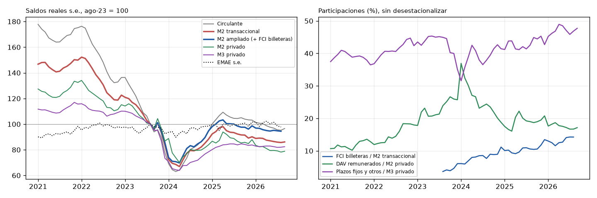

# Hipótesis 6: agregados alternativos (descriptivo)

Saldos reales s.e. (X13, última vintage), miles de millones de ARS de dic-2016. El M2 ampliado suma los FCI vía billeteras (stock de fin de mes, sin desestacionalizar) al M2 transaccional s.e.

| period   |   Circulante |   M2 transaccional |   M2 ampliado (+ FCI billeteras) |   M2 privado |   M3 privado |
|:---------|-------------:|-------------------:|---------------------------------:|-------------:|-------------:|
| 2023-08  |        216.7 |              603.5 |                            625.4 |        791.6 |       1457.7 |
| 2024-08  |        177.2 |              477.9 |                            514.5 |        630.4 |       1034.7 |
| 2025-08  |        226.2 |              557   |                            615.8 |        685.8 |       1221.8 |
| 2025-11  |        223.9 |              537.8 |                            601.1 |        671.6 |       1216.2 |
| 2026-04  |        213.9 |              528   |                            594.1 |        641.2 |       1209.2 |
| 2026-08  |        206.3 |              517   |                            590.6 |        619.1 |       1195.6 |

## Variación real s.e. (%)

|                   |   Circulante |   M2 transaccional |   M2 ampliado (+ FCI billeteras) |   M2 privado |   M3 privado |   EMAE s.e. |
|:------------------|-------------:|-------------------:|---------------------------------:|-------------:|-------------:|------------:|
| 2023-08 → 2024-08 |        -18.2 |              -20.8 |                            -17.7 |        -20.4 |        -29   |        -2.9 |
| 2024-08 → 2025-08 |         27.6 |               16.5 |                             19.7 |          8.8 |         18.1 |         2.3 |
| 2025-08 → 2026-08 |         -8.8 |               -7.2 |                             -4.1 |         -9.7 |         -2.1 |        -1.5 |
| 2025-11 → 2026-08 |         -7.9 |               -3.9 |                             -1.7 |         -7.8 |         -1.7 |        -0.6 |

